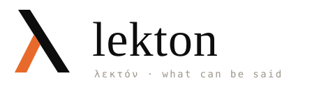

<p align="center">
  <picture>
    <source media="(prefers-color-scheme: dark)" srcset="https://raw.githubusercontent.com/griggz/lekton/main/assets/logo-dark.svg">
    
  </picture>
</p>

# lekton

Claim kinds built from one primitive.

A thought is the primitive. Every other kind of claim is a thought plus something, and there are only three ways to add:

| Relation | Meaning | In code |
|---|---|---|
| is-a | The kind adds fields to its parent and never removes any | Subclass it |
| made-of | The kind is made of other claims, each in a named role | `composed_of(...)` |
| requires | The kind owes an edge to another claim | `requires(...)` |

The name is Stoic. A *lekton* is "what can be said": the content of an utterance, apart from its words. The Stoics sorted lekta into kinds (assertions, questions, commands) about 2,300 years ago.

The mark is a lambda, the first letter of λεκτόν, drawn as two strokes: a thought, and what you add to it.

Status: v0. The shape of the shipped kinds may still change.

```bash
pip install lekton
```

## Background

`lekton` makes the nodes of a knowledge graph easier to define, generate, and curate. It treats claims as separate from things. A person, a company, or a tool is a thing. What someone decided or believed about it is a claim. Every claim is about at least one thing, and every claim has an author and a time.

Things already have standards. schema.org and Wikidata describe people, organizations, and places, and individual fields keep their own ontologies, such as the Open Energy Ontology for energy systems. Those standards exist because the world mostly agrees on what a person or a power plant is.

I have not found an open standard for how to structure a claim. Nanopublications, Wikidata's statement model, and PROV-O cover who said something and when. Nothing covers the kinds. Claims are more complex than things, and one person structures a claim differently than the next.

So `lekton` builds claims in layers of abstraction. A thought is the most basic claim. The first layer above it holds kinds that add something to a thought, such as a question or a decision. Layers above that combine kinds from the first, so one claim can be made of others.

The open work is defining that first layer: which kinds belong in it, and what each one adds. The library ships a question and a decision as the start.

Everything past the first layer should become standard by adoption, not decree. Nobody decreed schema.org. Usage made it the standard.

The longer argument is in [From Knowledge to Context](https://griggz.com/writing/from-knowledge-to-context).

## What a claim is

A claim is content someone put into words. Two marks tell it from a thing:

1. **It is about things.** It takes something as its subject.
2. **It can be taken up.** Agreed with or disputed, answered, followed or refused. It need not be; it can be.

A thing has an identity and is pointed at. A report, a process, a painting, a team: each has an author or a founder, and none of them can be disputed. What they say, do, or cost can be, and those are claims about them. A claim also has an author and a time, which is what lets a graph keep it and tell one from another, but so do many things. Provenance makes a claim recordable. Aboutness and force make it a claim.

The line is enforced in the shape: a claim carries a `record` and is `about` at least one thing; a thing appears in `about`.

The second mark sorts claims at the top. The Stoics did this first, by what an utterance admits of:

| It admits of | The Stoics called it | In lekton |
|---|---|---|
| Agreement or dispute | an assertion | `assertion`, with a modality |
| An answer | a question | `Question` |
| Being followed or refused | a command | Not yet. See [Not here yet](#not-here-yet) |

The same words can be any of the three. "Send the agenda the day before" is an instruction. "Every demo that went well, the agenda went out the day before" is an assertion. "The agenda step of the demo process" is a thing. One word, "pattern," gets used for all three, which is why structure decides and the label does not.

Claims come in particulars and generalities, as things come in individuals and categories. "This demo went well" is particular. "Demos go well when the agenda goes out early" is general, and it is made of particulars: a regularity is seen in two or more claims. A kind, such as decision or regularity, is a category of claim, which is what a template declares.

## What this library is for

It gives you the building blocks to programmatically define the kinds of claims you make.

- **Compose.** A person or an agent can build a kind from a few parts, then build larger kinds out of those, until they have an ontology of claims.
- **Deconstruct.** Any kind can be taken apart into its parent, the fields it adds, the claims it is made of, and the edges it owes. That includes someone else's, so you can see what makes their ontology theirs.
- **Test.** A kind is structure, so a claim can be checked against it in code. You can write tests against your claims.

It does not police how you use them.

| | What the library does | Example |
|---|---|---|
| Shape | Enforces it | A thought is about at least one thing. A composite fills every role it declares |
| Completeness | Reports it, never blocks | A decision with no question is `owed`, not rejected |
| Diligence | Stays out of it | Whether your extractor worked hard on modality |

The library makes claims comparable. Whether they are good is up to the system you build around it. There is no strict mode, on purpose.

## A thought

```python
from lekton import Thought, Question, Decision, Record, Assertion

thought = Thought(
    record=Record(author="wayne", captured_from="working session"),
    body="I do not think I ever use the traverse tool.",
    about=[{"thing": "traverse tool", "role": "subject"}, "Postgres port"],
    assertion=Assertion(
        predicate="is never used by me", modality="hypothesis", basis="stated"
    ),
)
```

- `record` holds facts about the thought: who, when, out of what, which version. Nobody has to agree with a claim to agree on its record.
- `body` is what was said, verbatim.
- `about` is everything it touches. There must be at least one.
- `assertion` is optional: the body reduced to one statement someone can agree or disagree with.

### Modality

An assertion carries the speaker's footing. The statement stays the same; the footing changes how much weight it can bear.

| Modality | The footing |
|---|---|
| `asserted` | I am telling you it is so |
| `hypothesis` | My guess, not checked |
| `forecast` | About the future; nobody can check it yet |
| `reported` | Someone else's word, passed along |
| `unstated` | Nobody said, and it could not be told. The default |

`unstated` is the default so that a claim nobody examined never passes as a firm one. A question's assertion stays `unstated`: nothing is asserted until its blank is filled.

`basis` says how the modality is known: `stated` when the speaker's own words carried it ("I think", "Dave told me"), `inferred` when whoever recorded the claim read it in. An `unstated` modality has no basis.

Modality is not confidence. It is the kind of footing, not how sure the speaker is.

## Your own kinds

```python
from lekton import composed_of

class Risk(Thought):                 # is-a: two fields about the claim itself
    likelihood: str
    impact: str

class Bet(Thought):                  # made-of: a bet backs a decision, exposed to a risk
    thesis: str
    parts = composed_of(backs=Decision, exposed_to=Risk)
```

Each role in `composed_of` is a verb. A bet carries a `backs` edge to a decision and an `exposed_to` edge to a risk; the parts stay as they were said, and the bet only points at them.

**When is something a field, and when is it a part?** A field is about the claim: how likely, how bad, what would settle it. A claim about the world is another claim, and it belongs in a role. The test is whether someone could disagree with it on its own. If they could, it is a thought with its own author and time, and it can be contradicted or superseded later without touching the claim that points at it.

That is why `Decision` adds no fields:

```python
class Decision(Thought):
    parts = composed_of(passed_over=Thought)
    needs = requires(because=Thought, resolves=Question)
```

What was chosen is the decision's own body. Each alternative is a claim linked with `passed_over`, the reason is a claim linked with `because`, and the question it answers is owed. A thought with a `passed_over` edge is a decision, by structure.

`Question` and `Decision` ship with the library because we hold an opinion about what they are. Everything else is yours to define.

## Structure decides, not the label

`check` reports what a claim is by what it carries. It never raises on a claim that falls short.

```python
from lekton import check, promote

alternative = Thought(
    record=Record(author="wayne"),
    body="A read-only SQL tool with the same gating could replace it.",
    about=["traverse tool"],
)
decision = promote(
    thought, Decision,
    body="Retire the traverse tool in the Postgres port.",
).with_link("passed_over", alternative)

report = check(decision, known=[alternative])
report.fits        # True: it passed something over
report.complete    # False
report.owed        # ('because: thought', 'resolves: question')
```

A report separates four things:

| Field | Meaning |
|---|---|
| `missing` | Fields or parts it lacks. Without them it is not this kind |
| `owed` | Required edges not in place. It is this kind, but incomplete |
| `unverified` | Edges that exist but point at claims that could not be looked up |
| `revised` | Linked claims that now have a newer version than the one pinned |

Related functions:

- `promote(thought, Kind, **adds)` makes a new claim with its own record and an `evolved_from` edge. The thought is left alone. Parts are edges, so add them afterwards with `with_link`.
- `with_link(verb, to, basis=..., by=...)` records how an edge is known, with the same `stated` or `inferred` an assertion uses, and who drew it. An edge nobody examined claims nothing. The library keeps no weights; a graph that scores its edges carries the score on the `Link` as an extra field.
- `qualifies(claim)` returns the most specific kinds a claim's structure fits.
- `read(data)` builds a claim as the most specific known kind. A kind this process has never seen comes back as its nearest known ancestor, extra fields intact.
- `status(question, claims)` returns `open` or `answered`. It is worked out from edges every time and never stored.

## Kinds as data

A kind can be written out as a template and built back from one, with no code.

```python
from lekton import to_yaml, load_kinds

print(to_yaml(Question, Decision))
```

```yaml
question:
  specializes: thought
  adds:
    settled_by: text
    owner: text?
decision:
  specializes: thought
  parts:
    passed_over: thought
  requires:
    because: thought
    resolves: question
```

`to_yaml` writes a template closed: a decision brings the question it resolves, so what it writes loads on its own. The shipped kinds are in this format at `lekton/kinds.yaml`, and a template of yours can name them without declaring them.

```python
built = load_kinds("""
hazard:
  specializes: thought
  adds:
    likelihood: low|medium|high
    impact: text
""")
Hazard = built["hazard"]
```

Types: `text`, `integer`, `number`, `boolean`, `date`, `datetime`, a list `[text]`, or a choice `a|b|c`. A trailing `?` marks a field optional. A required text or list field must not be empty.

## Rules the library enforces

1. A claim is about at least one thing.
2. A kind adds to its parent. Redefining an inherited field is an error.
3. A composite names at least one role, and a claim fills a role with edges to claims of that kind, as many as the role asks for. Without them, the claim is not that kind.
4. A required edge is a completeness check, not a gate. A decision with no question is still a decision.
5. A kind that adds nothing required cannot be told from its parent by structure, so `qualifies` and `read` never guess it.
6. An `unstated` modality carries no basis.

## Not here yet

- A mood for commands. An instruction, a practice, a rule to follow is about things and can be followed or refused, so it is a claim, but it has no truth value, and `assertion` can only say how sure the speaker is that something is so. A practice is written today as a thought whose body is the instruction; the library cannot yet tell it from an assertion by structure.
- Storage, a graph, or an MCP server. This is the model layer only.
- Versioning beyond the pin on an edge.
- Namespaces for kinds, and versions of a kind's own definition.
- Reference types (`person`, `thing`, `source`). They are plain text for now.

## For agents

lekton is meant to be picked up by an agent working for a person, as much as by the person.

| If you are | Start here |
|---|---|
| An agent that needs the docs | [`llms.txt`](https://github.com/griggz/lekton/blob/main/llms.txt), an index of every page as Markdown |
| An agent recording claims for someone | [`skills/lekton/SKILL.md`](https://github.com/griggz/lekton/blob/main/skills/lekton/SKILL.md) |
| Wiring lekton into tool calls or structured output | [Using lekton from an agent](https://github.com/griggz/lekton/blob/main/docs/agents.md) |
| Working on this repository | [`AGENTS.md`](https://github.com/griggz/lekton/blob/main/AGENTS.md) |

More in [`docs/`](https://github.com/griggz/lekton/tree/main/docs), and runnable scripts in [`examples/`](https://github.com/griggz/lekton/tree/main/examples).

## Development

```bash
uv sync
```

```bash
uv run pytest
```

## License

Apache-2.0. See [LICENSE](https://github.com/griggz/lekton/blob/main/LICENSE).
